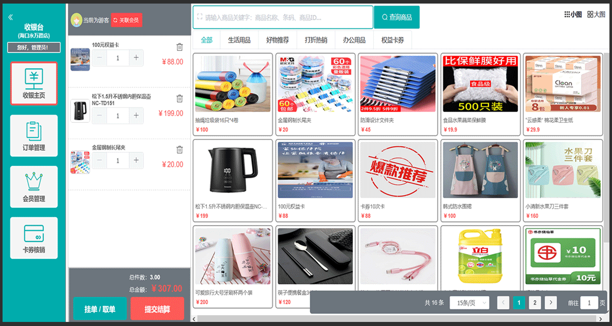
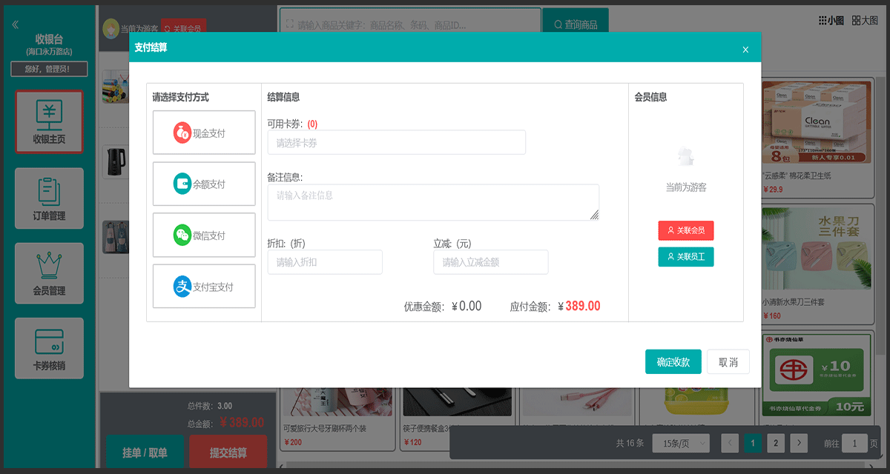

# fuint门店收银系统

#### 收银系统介绍
fuint门店收银系统前端仓库，该系统可用范围：零售超市、甜品店、餐饮奶茶店、美容足疗店等实体店铺的会员收银系统。
以下是前台的页面展示：

fuint侧重于线下实体店的私域流量的运营，同时提供会员端小程序和收银系统的线上线下统一渠道，帮助商户降低获客成本。顾客通过扫码支付成为私域流量，支付即可成为会员。积分和卡券功能建立起会员等级体系，通过消息推送和短信营销方便触达用户。
1. 会员运营自动化：商家通过日常活动设置，如开卡礼设置，沉睡唤醒等，成为会员后自动给顾客送优惠券，让顾客更有黏性，提升会员运营效率。
2. 打通收银系统和会员营销的壁垒，代客下单收银，支付即成为会员。
3. 会员体系完整化：积分兑换、积分转赠、会员等级权益、积分加速、买单折扣。
4. 会员卡券齐全：储值卡、电子券、优惠券、集次卡、计次卡、实体卡购买并兑换、会员充值、余额支付。
5. 线上代客下单收银系统，后台管理员可帮助临柜的会员下单、扫码支付。
6. 支持手机短信、站内弹框消息、微信订阅消息：支持包括发货消息、卡券到期提醒、活动提醒、会员到期提醒、积分余额变动提醒等消息。

#### 官网演示地址：
1. 官网：https://www.fuint.cn  点击 -> 系统演示，演示账号：fuint / 123456
2. swagger接口文档：https://www.fuint.cn/fuint-application/swagger-ui.html
3. 网页版本演示：https://www.fuint.cn/fuintCashier/
4. 下载windows安装包：https://www.fuint.cn/download?v=fuintCashier.exe

#### 软件架构
后端：JAVA SpringBoot + MYSQL Mybatis Plus + Redis
前端：采用基于Element UI，前后端分离，支持微信小程序、h5等

#### 前端使用技术
1. Vue3
2. Electron-Vue-template
3. Element UI
4. Nodejs 16+

#### 后端使用技术
1. SpringBoot 3.2
2. Mybatis Plus
3. Maven
4. SpringSecurity
5. Druid
6. Slf4j
7. Fastjson
8. JWT
9. Redis
10. Quartz
11. Mysql 5.7或8版
12. Swagger UI

#### 允许使用范围：
1. 允许个人学习使用
2. 允许用于毕业设计、论文参考代码
3. 推荐Watch、Star项目，获取项目第一时间更新，同时也是对项目最好的支持
4. 希望大家多多支持原创软件
5. 请勿去除版权标签，要商用请购买源码授权（非常便宜），感谢理解！

不足和待完善之处请谅解！源码仅供学习交流，更多功能欢迎进群咨询讨论，或需安装帮助请联系我们（<b>麻烦先点star！！！！！！</b>）。 
官方网站：https://www.fuint.cn 
开源不易，感谢支持！ 
<b>作者wx：fsq_better：</b> 

特别鸣谢： 
1. Mybaits Plus: https://github.com/baomidou/mybatis-plus
2. Vue: https://github.com/vuejs/vue
3. Element UI Plus: https://element.eleme.cn
